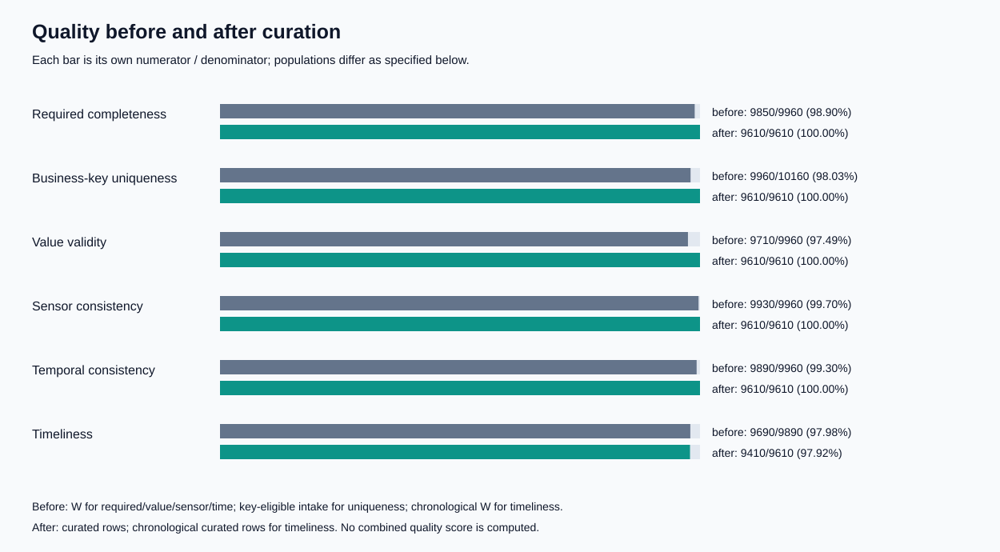

# BÁO CÁO CÁ NHÂN — INDIVIDUAL ASSESSMENT

**Học phần:** Cloud-Native Big Data Infrastructure & Governance

| Thông tin | Nội dung |
|---|---|
| Họ và tên | Lê Toàn |
| MSSV | 24022466 |
| Vai trò | Role B — Quality |
| Nhiệm vụ | Task 2 — Profile and measure quality |
| Bài thực hành | Lab 2 — Data Curation, Quality & Metadata Governance |
| Namespace của nhóm | `bd-g10` |
| Context Kubernetes | `minikube` |
| Runtime pipeline theo run record | Python 3.11.17, DuckDB 1.4.5 |
| Runtime kiểm tra chéo | Ghi riêng trong `evidence/task2-check.json` |
| Run ID pipeline | `ebf648b9-1e3f-47a5-87f1-e0e8924005b4` |

---

## Phần 1: Đóng góp kỹ thuật (10 điểm)

### Trước khi thực hiện

Nhóm nhận hai nguồn quan trắc nhiệt độ ở định dạng CSV và JSON Lines, kèm sensor registry và mẫu tham chiếu QA. Dữ liệu có giá trị thiếu, bản ghi trùng, timestamp không hợp lệ, unit không hỗ trợ và các dòng JSON lỗi. Việc đọc dữ liệu thành công chưa đủ để khẳng định dữ liệu đạt chất lượng hoặc đủ điều kiện phát hành.

Vai trò của tôi là phụ trách phần Quality: xác định quần thể và mẫu số, định nghĩa phép đo SQL, phân tích lỗi và báo cáo before/after. Báo cáo này cập nhật theo candidate thực tế của bộ bài tổng hợp, thay cho kết quả diagnostic ở checkpoint Task 2 cũ. Việc phân công vai trò không thay thế bằng chứng tác giả và demo cá nhân.

### Công việc và artifact kỹ thuật

- **Typing và cohort:** trim, uppercase identifiers; ghi nhận giá trị không parse được; xác định key-eligible và deterministic winners trước lọc validity.
- **Metric:** completeness, uniqueness, value validity, sensor consistency, chronology và timeliness có mẫu số riêng. QA coverage và agreement được báo cáo riêng.
- **Điều tra lỗi:** lưu số lượng và physical source references; không đưa email hoặc raw payload vào báo cáo chung.
- **After-quality:** đối chiếu trực tiếp candidate Parquet; giữ kết quả diagnostic cũ làm lịch sử.
- **Kiểm tra chéo:** tính lại after-quality bằng Python/Decimal và kiểm tra conservation bằng tập physical IDs trên các artifact hiện có.

Các artifact chính:

- [typed.sql](../code/typed.sql), [quality.sql](../code/quality.sql), [quality_report.py](../code/quality_report.py).
- [quality_before.json](../quality_before.json), [quality_after.json](../quality_after.json): cohort, numerator, denominator, thresholds, status, counts và defect samples.
- [curated.parquet](../candidate/curated.parquet), [run-record.json](../run-record.json).
- [check_task2.py](../code/check_task2.py), [task2-check.json](../evidence/task2-check.json): chương trình và kết quả kiểm tra chéo.

### Quần thể đánh giá

Before-quality population **W** là tập winners trước khi lọc row validity. Winner được chọn theo `ingest_ts DESC`, `source_object ASC`, `source_row ASC`. Completeness, value validity, sensor consistency và chronology dùng toàn bộ W. Uniqueness trước xử lý dùng key-eligible records trước dedup. Timeliness chỉ dùng các hàng chronology hợp lệ.

| Thành phần | Số bản ghi |
|---|---:|
| Raw physical records | 10.205 |
| Parse failures được giữ trong envelopes | 5 |
| Parsed intake | 10.200 |
| Parsed records bị loại trước dedup do KEY hoặc INGEST_PARSE | 40 |
| Key-eligible trước dedup | 10.160 |
| Duplicate excess | 200 |
| W — winners trước lọc validity | 9.960 |
| Required-field failures trong parsed intake | 130 |
| Curated candidate | 9.610 |

Quan hệ intake là `10.205 = 5 + 40 + 200 + 9.960`. Có 350 winner không đạt validity; tổng quarantine là `5 + 40 + 350 = 395`. Quan hệ số lượng được kiểm tra thêm bằng tập physical IDs ở Phần 2.

### Kết quả trước xử lý

| Metric | Tử số | Mẫu số | Giá trị | Ngưỡng | Trạng thái |
|---|---:|---:|---:|---:|---|
| Required-field completeness | 9.850 | 9.960 | 98,8956% | 100% | FAIL |
| Business-key uniqueness | 9.960 | 10.160 | 98,0315% | 100% | FAIL |
| Value validity | 9.710 | 9.960 | 97,4900% | 100% | FAIL |
| Sensor consistency | 9.930 | 9.960 | 99,6988% | 100% | FAIL |
| Temporal consistency | 9.890 | 9.960 | 99,2972% | 100% | FAIL |
| Timeliness | 9.690 | 9.890 | 97,9778% | 95% | PASS |

Timeliness loại riêng 70 winner không có chronology hợp lệ khỏi mẫu số. Required predicates trả về NULL được xem là thất bại; cohort rỗng có `value=null` và `status=NOT_EVALUATED`, không được coi là 100%.

| Nhóm lỗi | Quần thể | Số lượng | Ví dụ source reference |
|---|---|---:|---|
| PARSE | Raw intake | 5 | `observations_b.jsonl:5201` |
| KEY | Parsed intake trước dedup | 20 | `observations_a.csv:341` |
| INGEST_PARSE | Parsed intake trước dedup | 20 | `observations_a.csv:361` |
| REQUIRED | W | 110 | `observations_a.csv:1` |
| NUMERIC | W | 170 | `observations_a.csv:1` |
| UNIT | W | 40 | `observations_a.csv:161` |
| REFERENCE — sensor registry | W | 30 | `observations_a.csv:311` |
| TIME | W | 70 | `observations_a.csv:241` |

Các nhóm có thể chồng lấp, nên không cộng trực tiếp để tính tổng hàng bị loại. `source_row` của CSV là ordinal của data record, không tính header; JSON Lines dùng line ordinal. Reason `REFERENCE` chỉ sensor không có trong registry, khác với QA agreement.

### Kết quả sau curation và giới hạn

Candidate thực tế có **9.610 hàng**, tương ứng **94,17% raw intake** hoặc **96,49% W**. After-quality sử dụng [quality_after.json](../quality_after.json) của run tổng hợp. Kiểm tra chéo đọc trực tiếp Parquet và tính lại cả tám cặp numerator/denominator, không nhập SQL production vào chương trình kiểm tra.

| Metric | Tử số | Mẫu số | Giá trị | Trạng thái |
|---|---:|---:|---:|---|
| Required-field completeness | 9.610 | 9.610 | 100% | PASS |
| Business-key uniqueness | 9.610 | 9.610 | 100% | PASS |
| Value validity trên giá trị đã xuất | 9.610 | 9.610 | 100% | PASS |
| Sensor consistency | 9.610 | 9.610 | 100% | PASS |
| Temporal consistency | 9.610 | 9.610 | 100% | PASS |
| Timeliness | 9.410 | 9.610 | 97,9188% | PASS |
| QA coverage | 100 | 100 | 100% | PASS |
| QA agreement | 95 | 100 | 95% | PASS |



Completeness tăng vì hàng thiếu bị loại, không chứng minh giá trị thiếu đã được phục hồi. Timeliness giảm nhẹ do thay đổi mẫu số; 200 hàng trễ hợp lệ vẫn được giữ. QA chỉ đánh giá 100 reference IDs, không chứng minh độ chính xác của mọi quan trắc thực tế. Không dùng reference để sửa, impute hoặc chọn measurement.

Kiểm tra value độc lập áp dụng cho `DECIMAL(8,2)` đã xuất; nó không chứng minh độc lập range trước rounding. Task 2 đạt ngưỡng không đồng nghĩa toàn bộ release gate và review độc lập đã hoàn tất.

---

## Phần 2: Kiểm tra thực hành độc lập (10 điểm)

**Kiểm tra chéo thuộc nhiệm vụ Task 2 của Role B:** tính lại conservation và uniqueness trên sản phẩm Curation, dự đoán kết quả, thực hiện kiểm tra và giải thích bằng chứng.

### Dự đoán và phương pháp

Dự đoán: candidate có 9.610 business keys duy nhất; raw có 10.205 physical IDs; hai ledger có 395 và 200 hàng. Mỗi physical ID phải có đúng một terminal disposition.

[check_task2.py](../code/check_task2.py) đọc Parquet bằng DuckDB, sau đó dùng Python/Decimal để tính after-quality và `Counter`/`set` để kiểm tra conservation. Chương trình không gọi `curate.sql` hoặc `quality.sql`, không dùng các cờ PASS đã lưu để quyết định kết quả. Các số đếm tính mới được so sánh với báo cáo hiện có.

Từ thư mục `bigdata2`, chạy với Python có DuckDB:

```powershell
python -X utf8 code/check_task2.py
```

Kết quả mới được ghi vào `evidence/task2-check.json`; exit code khác 0 nếu kiểm tra thất bại. Lệnh không kết nối S3 và không ghi đè run record cũ.

### Kết quả kiểm tra chéo

| Kiểm tra | Kết quả đo | Trạng thái |
|---|---|---|
| Count reconciliation | `10.205 = 9.610 + 395 + 200` | PASS |
| Raw IDs thiếu trong hợp ba đầu ra | 0 | PASS |
| Output IDs không có trong raw | 0 | PASS |
| Giao từng cặp đầu ra | 0 ở cả ba cặp | PASS |
| Physical IDs lặp trong raw và từng đầu ra | 0 | PASS |
| Curated business-key uniqueness | 9.610 IDs / 9.610 hàng | PASS |
| Candidate hash so với run record | Khớp | PASS |
| Tám metric after so với báo cáo | Khớp toàn bộ numerator/denominator | PASS |
| Site so với sensor registry | Khớp toàn bộ candidate | PASS |
| Cờ is_late so với lag thực tế | Khớp toàn bộ candidate | PASS |
| Bốn nguồn snapshot so với trusted manifest | Khớp byte và hash sau khôi phục xuống dòng | PASS |

Tổng số lượng bằng nhau vẫn có thể che giấu một hàng mất và một hàng lặp. Vì vậy cần kiểm tra hiệu tập, giao tập và multiplicity theo `(source_object, source_row)`; không dùng business ID thay physical ID.

### Nguồn gốc và giới hạn bằng chứng

Khi kiểm tra artifact, hai ledger lịch sử không có trong checkout. Hai tệp trong `restricted/` được tái tạo từ envelopes bằng SQL hiện có; candidate tính lại có symmetric difference bằng 0 so với Parquet đã bàn giao. [reconstruction-record.json](../restricted/reconstruction-record.json) lưu thời gian, phương pháp và hash mới:

- `duplicates.csv`: 200 hàng, khớp cả hash lịch sử.
- `quarantine.csv`: 395 hàng; hash khác bản lịch sử. Đây là bản tái tạo, không được coi là tệp gốc của run cũ.

Conservation nêu trên áp dụng cho **candidate thực tế và hai ledger tái tạo hiện có**. Nó không chứng minh lại byte của quarantine lịch sử. Hai ledger chỉ dành cho bộ nộp hạn chế, không đưa vào analyst release.

**Trạng thái đánh giá cá nhân:** kiểm tra chéo đã thực thi tự động, có runtime, timestamp, check run ID, hash chương trình và artifact hashes. Chưa có xác nhận Lê Toàn trực tiếp demo trước reviewer; `human_demo_attested=false`. Cần tự chạy lại, giải thích kết quả và lưu reviewer thực tế khi thực hiện demo theo yêu cầu đề. Kết quả tự động không nhận thay phần điểm demo cá nhân.

---

## Phần 3: Câu hỏi vấn đáp (10 điểm)

Các câu dưới đây là nội dung chuẩn bị giải thích thiết kế. Exit response chính thức được giảng viên giao riêng; chưa xác nhận đã thực hiện.

### Câu 1

**Vì sao before-quality phải dùng winners trước lọc validity, và vì sao uniqueness dùng mẫu số khác?**

Winners đại diện cho các phiên bản được policy chọn, bao gồm cả phiên bản lỗi. Nếu lọc trước khi đo, lỗi biến mất khỏi mẫu số. W có 9.960 hàng nhưng chỉ 9.850 hàng đủ trường bắt buộc, nên completeness before là 98,8956%. Sau khi giữ 9.610 hàng hợp lệ, completeness đạt 100% do thay đổi quần thể, không phải khôi phục giá trị thiếu.

Uniqueness phải dùng key-eligible intake trước dedup: 9.960 IDs trên 10.160 records, tương ứng 200 duplicate excess. Nếu dùng W, uniqueness luôn 100% vì mỗi ID đã có một winner.

### Câu 2

**Vì sao chọn winner trước validity và không thay winner lỗi bằng bản cũ hợp lệ?**

Contract chọn ingest time lớn nhất, sau đó tie-break bằng source object và source row. Nếu lọc validity trước dedup, bản mới invalid có thể biến mất và bản cũ được chọn, che giấu lỗi cập nhật. Bản mới phải được đánh giá và cách ly nếu lỗi; bản cũ thuộc duplicates. Tie-break theo provenance giúp kết quả ổn định khi đổi thứ tự đọc đầu vào.

### Câu 3

**Vì sao tách QA coverage, agreement và timeliness thay vì gộp một điểm?**

Coverage đo reference IDs được kiểm tra; agreement đo mức gần reference trên các ID đã match. Candidate có coverage 100/100 và agreement 95/100. Nếu bỏ một ID đang lệch, agreement có thể tăng thành 95/99 nhưng coverage giảm còn 99/100. Vì vậy cần cả hai chỉ số và không dùng reference để sửa hoặc chọn measurement.

Timeliness chỉ dùng cohort chronology hợp lệ. Before có 70 hàng bị loại khỏi mẫu số này; kết quả là 9.690/9.890. After có 200 hàng trễ vẫn hợp lệ, cho 9.410/9.610. Late không đồng nghĩa measurement sai. Một điểm trung bình có thể che giấu quy tắc bắt buộc thất bại; cần báo cáo từng numerator, denominator, threshold và status.

---

**Lê Toàn — MSSV: 24022466 — Role B**

**Trạng thái hoàn thiện:** tính toán Task 2, after-quality trên candidate thực tế và kiểm tra chéo conservation/uniqueness đã có bằng chứng. Conservation dùng ledger tái tạo với giới hạn nguồn gốc nêu trên. Demo cá nhân, reviewer và exit response chính thức còn chờ thực hiện.
