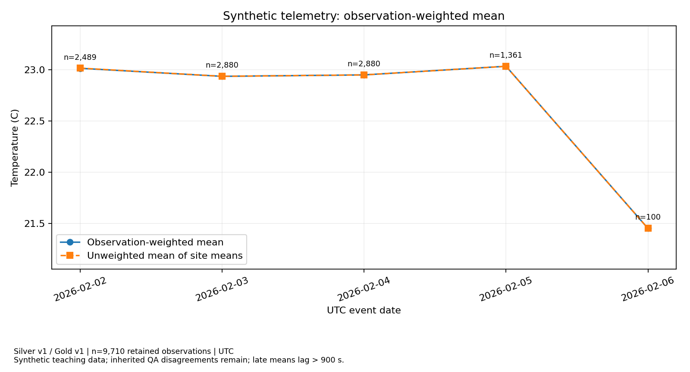
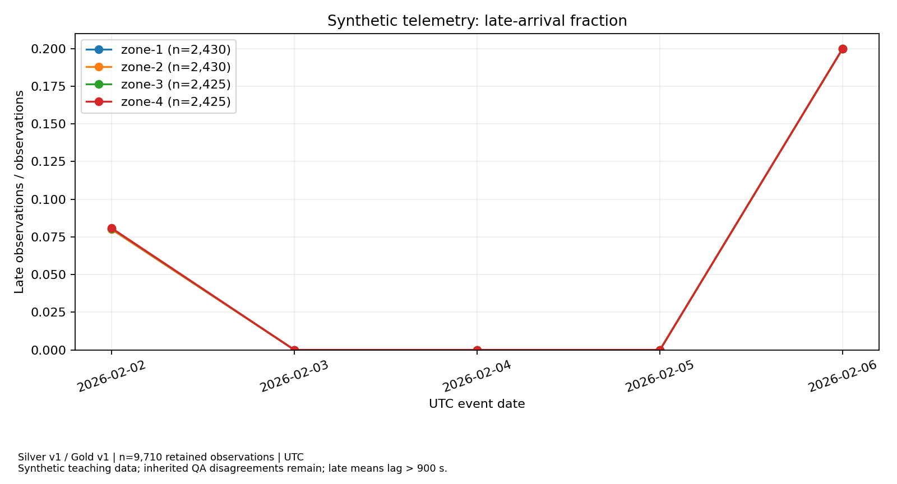

# Lab 3 — Lakehouse Processing & Analytics

Nhóm: `bd-g10`. Lượt chạy: `roleD-20261101`. Phần phụ trách: **Role D — 24022463 — Đàm Quang Tiến**.

## 1. Phạm vi và kết quả kiểm tra

Phần D gồm hàm `benchmark_query`, Q1/Q2/Q3, hai biểu đồ có phiên bản nguồn, thí nghiệm A/B và đối chiếu mẫu số của build_gold. Hồ sơ A của Trần Anh Tuấn (24022484) gồm kiểm tra đầu vào/runtime và truy vết snapshot đã ghim. Hồ sơ E của Lê Toàn (24022466) gồm release binding, catalog, lineage, review dữ liệu thực và kiểm tra chéo A. Ba hồ sơ dùng cùng bố cục đánh giá cá nhân. Các hàm mô hình và merge được tích hợp để tạo dữ liệu nguồn và kiểm tra tính tái lập của toàn bộ pipeline.

Đã chạy 35 kiểm tra giá trị xuất, 9 kiểm tra trực tiếp bảng Delta, 20 kiểm thử không bỏ qua ca nào, 10 kiểm tra D, 16 kiểm tra A và 16 kiểm tra E. Review E chạy năm gate bắt buộc và 35 ca từ chối bổ sung. Chi tiết nằm trong `evidence/independent_checks.json`, `live_table_verification.json`, `implementation_tests.json`, `role_D_check.json`, `role_A_check.json`, `role_E_check.json`, `release_review.json`. Các kết quả này xác nhận kiểm tra kỹ thuật bằng chương trình; phần trình bày cá nhân do thành viên thực hiện khi bảo vệ.

## 2. Đầu vào, runtime và snapshot

Sử dụng `course_fallback_not_student_approval`: CSV bàn giao gồm 9,610 quan sát, đúng mười cột phát hành Lab 2; đây là fallback học phần. SHA-256 manifest cung cấp riêng: `3cdfc84b26d290100b39ce65d4ff7cb22839f4021b9caf26897c8a4ff68091a2`. Digest logic ban đầu: `c50f8252bfb91890975d26b16fe1d2b32f0e283a58e46bd16260b4a3cca0bf0d`. Cả 16 tệp đã qua kiểm tra byte/hash; các bản bị đổi xuống dòng được khôi phục từ ZIP gốc theo hash cố định, ghi tại `input_restoration.json`. Không sửa hash kỳ vọng.

Runtime: Python 3.11.18, Spark 4.0.1, Delta 4.0.1, Java 17.0.21, Hadoop 3.4.1; UTC; AQE=true; shuffle partitions=8. Spark standalone dùng hai worker container và S3A dùng chung. Các container không chứng minh có hai máy chủ vật lý. Image ID, thư viện và JAR được lưu trong `container_images.txt`, `requirements.lock.txt`, `jars.lock.json`.

| Lớp | URI cụ thể | Phiên bản đầu | Phiên bản sau cập nhật |
| --- | --- | --- | --- |
| bronze | s3a://research-lakehouse/lab3/bd-g10/roleD-20261101/tables/bronze | 0 | 1 |
| silver | s3a://research-lakehouse/lab3/bd-g10/roleD-20261101/tables/silver | 0 | 1 |
| gold | s3a://research-lakehouse/lab3/bd-g10/roleD-20261101/tables/gold | 0 | 1 |

Bronze là biên nhận vật lý theo `(source_object, source_row, source_sha256)`. Silver chọn một bản ghi theo `record_id`, giữ mười cột và thêm ngày UTC. Gold chứa 20 nhóm site/ngày từ 9,710 quan sát; tổng nhiệt độ 222930.50 °C. Trường nguồn gốc được giữ để truy vết; dữ liệu thô và trường hạn chế nằm ngoài gói nộp.

Batch 02 có 140 dòng vật lý, 130 winner và 10 phiên bản bị thay thế trong batch. Quy tắc chọn là ingest giảm dần, object tăng dần, ordinal tăng dần. Quyết định: `{'updated_newer': 20, 'unchanged_stale': 10, 'inserted': 100}`. Bronze replay không nhân biên nhận; Silver replay v2 bằng nội dung Silver v1; đọc lịch sử v0 vẫn bằng handoff. Ba batch sai bị từ chối trước ghi. Minh chứng đầy đủ ở `incremental.json`, bốn bản xuất Silver, `row_trace.json` và `input_contract_tests.json`.

## 3. Q1 — KPI theo site/ngày

Q1 trả 20 dòng, bốn site trên năm ngày UTC: `n_observations`, `mean_temperature_c`, `n_late`, `late_rate`. Mẫu số là mọi quan sát được giữ của đúng site/ngày; không dùng số sensor và không loại quan sát đến muộn. `is_late` chỉ đúng khi độ trễ **lớn hơn** 900 giây. Đọc bảng Gold v1 tạo từ Silver v1 bằng `versionAsOf`.

Truy vấn: [Q1](../sql/Q1_site_day.sql). Kết quả: [JSON](../evidence/Q1_site_day.json), [CSV](../evidence/Q1_site_day.csv).

## 4. Q2 — Trung bình có trọng số và kiểm tra build_gold

Trung bình ngày = `SUM(sum_temperature_c) / SUM(n_observations)`. `AVG(mean_temperature_c)` cho mỗi site cùng trọng số dù số quan sát khác nhau. Kiểm tra D tính lại tử số/mẫu số trực tiếp từ toàn bộ bản ghi Silver đã xuất bằng Decimal rồi so với Gold và Q2.

| Ngày UTC | Tổng nhiệt độ (°C) | Số quan sát | Trung bình có trọng số (°C) | Trung bình các trung bình (°C) |
| --- | --- | --- | --- | --- |
| 2026-02-02 | 57283.50 | 2489 | 23.014665 | 23.016459 |
| 2026-02-03 | 66056.00 | 2880 | 22.936111 | 22.936111 |
| 2026-02-04 | 66096.00 | 2880 | 22.950000 | 22.950000 |
| 2026-02-05 | 31350.00 | 1361 | 23.034533 | 23.034212 |
| 2026-02-06 | 2145.00 | 100 | 21.450000 | 21.450000 |

Ngày 2026-02-02 minh họa rõ: 57283.50 / 2489 = 23.014665 °C; trung bình các site là 23.016459 °C. Sự khác nhau do số quan sát theo site không bằng nhau. Mẫu số gồm cả quan sát đến muộn. Số sensor phân biệt trong một site/ngày không cộng dồn thành số sensor phân biệt của toàn kỳ.

Truy vấn: [Q2](../sql/Q2_weighted_day.sql). Kết quả: [JSON](../evidence/Q2_weighted_day.json), [CSV](../evidence/Q2_weighted_day.csv). Đối chiếu: [role D](../evidence/role_D_check.json).

Biểu đồ ghi Silver/Gold, ngày UTC, đơn vị °C, tổng mẫu và số quan sát từng ngày. Ngày cuối chỉ có 100 quan sát, vì vậy không diễn giải biến động đó như xu thế tổng thể. Dữ liệu là fixture tổng hợp và vẫn có các bất đồng đo lường kế thừa với mẫu QA.

## 5. Q3 — Tỷ lệ vượt ngưỡng giảng dạy

Tử số là số nhiệt độ **> 25**, không gồm giá trị bằng 25. Mẫu số là toàn bộ quan sát site/ngày, kể cả đến muộn. Ngưỡng 25 °C phục vụ bài học; kết quả không phải kết luận an toàn hoặc hiệu chuẩn thiết bị. Bảng sau tóm tắt kết quả site/ngày, còn 20 dòng đầy đủ nằm trong tệp kết quả.

| Ngày UTC | Số > 25 °C | Tổng quan sát | Tỷ lệ site thấp nhất | Tỷ lệ site cao nhất |
| --- | --- | --- | --- | --- |
| 2026-02-02 | 739 | 2489 | 0.208000 | 0.409677 |
| 2026-02-03 | 832 | 2880 | 0.201389 | 0.395833 |
| 2026-02-04 | 841 | 2880 | 0.201389 | 0.402778 |
| 2026-02-05 | 406 | 1361 | 0.205882 | 0.411765 |
| 2026-02-06 | 0 | 100 | 0.000000 | 0.000000 |

Truy vấn: [Q3](../sql/Q3_above25_rate.sql). Kết quả: [JSON](../evidence/Q3_above25_rate.json), [CSV](../evidence/Q3_above25_rate.csv).

Biểu đồ thể hiện `n_late / n_observations`, có chú giải site, số mẫu theo site và phiên bản nguồn. Qua kiểm tra miền giá trị không chứng minh đo lường chính xác; QA dùng để đánh giá, không thay giá trị quan sát.

## 6. Thí nghiệm bố trí A/B

Đọc cùng Silver v1 gồm 9,710 dòng, nhân với 100 `replica_id` thành 971,000 dòng tổng hợp. Chỉ thu về driver bốn dòng tổng hợp. Replica không phải mẫu độc lập và không đi vào Gold vận hành.

A không partition, ghi bằng `repartition(32)`. B ghi bằng `repartition(5, event_date)` và `partitionBy(event_date)`. Dùng cùng runtime, snapshot, tài nguyên, AQE và `benchmark_query`: lọc 2026-02-06, group theo site; xuất count, tổng DECIMAL(18,2), số late. `replica_id` không nằm trong GROUP BY.

| Layout | Tổng file dữ liệu của bảng | Tổng byte | Thời gian chuẩn bị/ghi (s) |
| --- | --- | --- | --- |
| A | 32 | 16396223 | 29.679719 |
| B | 5 | 525397 | 8.687406 |

Mỗi layout warm-up một lần, sau đó đo A–B, B–A, A–B. Runner tạo DataFrame đọc snapshot trước mốc đồng hồ; khoảng đo bắt đầu khi dựng aggregate và kết thúc sau `collect()` của kết quả nhỏ, không chỉ đo dựng DataFrame. Thời gian ghi/chuẩn bị bảng nằm ngoài sáu phép đo.

| Lần | Vòng | Layout | Thời gian driver (s) | SQL execution ID | File thực đọc | Kết quả bằng nhau |
| --- | --- | --- | --- | --- | --- | --- |
| 1 | 1 | A | 2.123606627 | 37 | 32 | True |
| 2 | 1 | B | 0.878731415 | 39 | 1 | True |
| 3 | 2 | B | 0.845056880 | 41 | 1 | True |
| 4 | 2 | A | 1.871164200 | 43 | 32 | True |
| 5 | 3 | A | 1.751632112 | 45 | 32 | True |
| 6 | 3 | B | 0.859027120 | 47 | 1 | True |

Median A = **1.871164200 s**, median B = **0.859027120 s**, tỷ số median(A)/median(B) = **2.178236**. Sáu kết quả bằng nhau và bằng kết quả dựng từ Gold ngày tương ứng nhân hệ số 100. Tổng đáp án là 10.000 dòng workload, 2.500 cho mỗi site; không diễn giải thành 10.000 phép đo độc lập.

Plan A không có mục `PartitionFilters`; điều kiện ngày xuất hiện ở `PushedFilters` và node `Filter`. Plan B có `PartitionFilters` chứa `isnotnull(event_date)` và `event_date = 2026-02-06`, cho phép bỏ qua partition ngày khác; `event_date` không cần nằm trong ReadSchema của dữ liệu Parquet ở B. **Tổng file của bảng** từ Delta metadata khác **file thực đọc** từ scan-node metrics của Spark History Server. `benchmark_scan_metrics.json` gắn metric với tám execution: hai warm-up và sáu lần đo. Không suy số file đọc từ tổng file.

Các plan lưu bằng formatted explain có `isFinalPlan=false`, mô tả kế hoạch trước kết quả AQE cuối; scan metrics được lấy riêng từ SQL execution đã hoàn tất. `clearCache()` không xóa cache hệ điều hành/object store/JVM: đây là đọc lặp sau warm-up. Độ nén, kích thước file và chi phí scheduling cũng khác giữa A/B; kết quả không tách riêng tác động của partition pruning. Tỷ số chỉ mô tả fixture và lượt chạy này; không suy rộng hiệu năng production. Không có yêu cầu speedup tối thiểu.

Minh chứng: [report](../evidence/benchmark_report.json), [sáu thời gian](../evidence/benchmark_timings.csv), [plan A](../evidence/plan_A.txt), [plan B](../evidence/plan_B.txt), [metric thực đọc](../evidence/benchmark_scan_metrics.json).

## 7. Kiểm tra A/E và release candidate

A: 16/16 tệp, handoff logic, probe schema tám dòng và placement worker đều đạt trong lượt chạy hiện tại. Hồ sơ A được bổ sung bằng 16 kiểm tra, trong đó ba mẫu được lấy từ Silver v1 thật, đối chiếu đúng source object/ordinal/hash và liên kết với binding Silver v1/Gold v1. R010001 chọn source row 1 ở 19,10°C; dictionary giữ dòng gặp cuối sẽ lấy row 131 ở 20,10°C nên không được dùng làm quy tắc winner. Các lỗi byte và Java ngoài baseline của bản báo cáo cũ đã được xử lý trong cấu hình/bằng chứng mới. E: một candidate hợp lệ được nhận; mixed snapshot, tự review, thiếu steward và sai code hash bị từ chối. Kiểm tra bổ sung xác nhận từng khóa bắt buộc bị thiếu đều từ chối.

Candidate ghim Silver v1, Gold v1, nguồn Gold là Silver v1. Gold được tính lại từ bảng Silver đã ghim rồi so toàn bộ trường. SHA-256 implementation: `739d95ff27e0e85e8549b46d4b66d2c0f790bfab6873aa62dea490fa3f2b19e1`; bản đã thực thi nằm trong `code_versions/`. Catalog, manifest và lineage đi kèm candidate. Trạng thái là **CANDIDATE_NOT_OWNER_PUBLISHED**; nhãn reviewer trong metadata không thay chữ ký hoặc phần bảo vệ của thành viên.

Review E đọc lại Silver và Gold bằng versionAsOf, tính độc lập các trường Gold bằng Decimal/count/distinct mà không gọi `build_gold`; cả 20 nhóm × 11 trường khớp bảng và JSON candidate. Catalog khớp count, schema, đơn vị, UTC, allowed use và retention. Các sự kiện pipeline khớp schema OpenLineage và quan hệ snapshot; review E có cặp START/COMPLETE riêng. `release_review.json` ghi lý do và kết quả kỹ thuật, không tuyên bố chữ ký hoặc owner publication.

Mỗi lần ghi Delta là một giao dịch của một bảng. Cặp version và manifest giúp chọn đầu ra đã kiểm tra; chúng không tạo giao dịch xuyên bảng. Giữ các file/log còn được tham chiếu, không VACUUM. Bản Delta mang theo trong `portable_delta/` giữ cả log và dữ liệu để kiểm tra lịch sử khi tái lập.

## 8. Danh mục nộp và tái lập

- [Hồ sơ role A](../individual/24022484_TranAnhTuan_RoleA.md), [hồ sơ role D](../individual/24022463_DamQuangTien_RoleD.md), [hồ sơ role E](../individual/24022466_LeToan_RoleE.md), [kiểm tra A/E](../KIEM_TRA_ROLE_A_E.md).
- `templates/student_impl.py`, `sql/`, `contributions.csv`, `manual_checks.csv`.
- `evidence/`: phiên bản, snapshot, SQL, biểu đồ, timing, plan, metric, lineage, catalog, candidate và kiểm tra.
- `portable_delta/`: bản sao đúng byte của các object Delta được tham chiếu.
- `Setup-Lab3.ps1`, `Run-Lab3.ps1`: chuẩn bị môi trường và chạy tuần tự. README mô tả khôi phục dữ liệu gốc.

Tài liệu kỹ thuật: [Spark 4.0.1 performance tuning](https://spark.apache.org/docs/4.0.1/sql-performance-tuning.html), [Delta MERGE](https://docs.delta.io/delta-update/).
