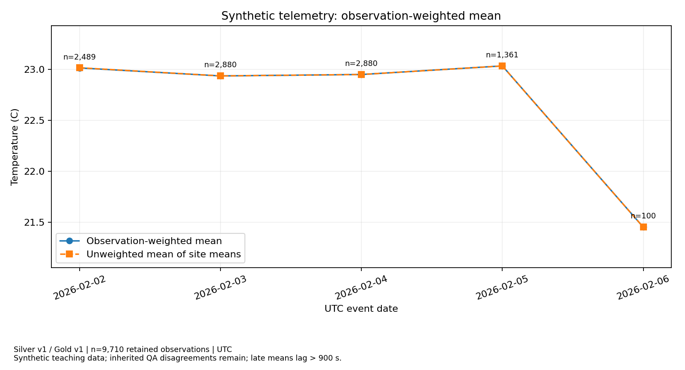
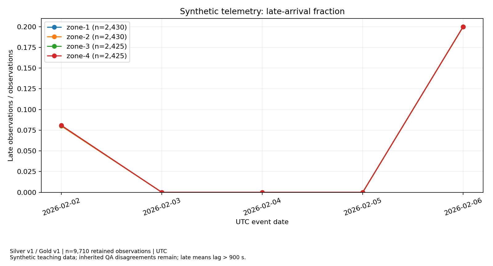

# BÁO CÁO CÁ NHÂN — INDIVIDUAL ASSESSMENT

**Học phần:** Cloud-Native Big Data Infrastructure & Governance  
**Bài thực hành:** Lab 3 — Lakehouse Processing & Analytics  
**Package Revision:** 18 September 2026

| Thông tin | Nội dung |
|---|---|
| Họ và tên | Đàm Quang Tiến |
| MSSV | 24022463 |
| Vai trò | Role D — Analytics & Measurement |
| Nhiệm vụ chính | Task 4 — benchmark_query, SQL interpretation, plots & controlled layout experiment |
| Nhiệm vụ chéo | Kiểm tra build_gold: weighted mean and observation denominator |
| Nhóm thực hiện | `{{GROUP_ID}}` |
| Run Label | `{{RUN_LABEL}}` |
| Context / Chế độ chạy | Spark standalone: hai worker container, S3A dùng chung (Spark {{SPARK}}, Delta-Spark {{DELTA}}, Python {{PYTHON}}, Java {{JAVA}}, Hadoop {{HADOOP}}) |
| Trusted Manifest SHA-256 | `{{TRUSTED_SHA}}` |
| Upstream Logical SHA-256 | `{{HANDOFF_LOGICAL_SHA}}` |
| Run ID Benchmark | `{{BENCHMARK_RUN_ID}}` |
| Cặp snapshot phân tích | Silver v{{SILVER_VERSION}} / Gold v{{GOLD_VERSION}}; Gold được tạo từ Silver v{{GOLD_SOURCE_VERSION}} |

---

## Phần 1: Đóng góp kỹ thuật (10 điểm)

### 1.1 Trước khi thực hiện (Bối cảnh và thách thức)

Sau khi tiếp nhận dữ liệu Lab 2 và áp dụng batch revision của Lab 3, nhóm cần tạo các chỉ số có thể tái lập và đo ảnh hưởng của bố trí lưu trữ tới truy vấn. Phần phân tích phải sử dụng đúng dữ liệu vận hành sau cập nhật; một biểu đồ hoặc thời gian chạy đơn lẻ chưa đủ để chứng minh kết quả đúng.

1. **Ghim phiên bản nguồn (Snapshot Reproducibility):** Q1–Q3 đọc Gold v{{GOLD_VERSION}}, được tạo từ Silver v{{GOLD_SOURCE_VERSION}}. Benchmark đọc đúng Silver v{{SILVER_VERSION}}; không thay bằng bảng latest khi diễn giải kết quả.
2. **Giữ đúng ý nghĩa chỉ số (KPI Semantics):** Trung bình ngày phải dùng tổng nhiệt độ chia tổng số quan sát. Tỷ lệ late và tỷ lệ vượt 25°C dùng toàn bộ quan sát site/ngày làm mẫu số, kể cả các quan sát đến muộn hợp lệ.
3. **Đo hai layout có kiểm soát (Controlled Measurement):** A/B dùng cùng snapshot, biểu thức truy vấn, hệ số nhân bản, runtime, tài nguyên và AQE. Tách thời gian ghi bảng khỏi thời gian đánh giá truy vấn; kiểm tra đáp án bằng nhau trước khi so tốc độ.
4. **Diễn giải đúng bằng chứng (Plan & Metric Interpretation):** Phân biệt số file của cả bảng với số file thực đọc, thao tác dựng DataFrame với thực thi truy vấn, và đọc lặp sau warm-up với cold-cache benchmark.

Vai trò của tôi (Đàm Quang Tiến — Thành viên D) là phụ trách hàm `benchmark_query`, diễn giải ba truy vấn SQL, trình bày hai biểu đồ và phân tích thí nghiệm layout A/B. Phần kiểm tra chéo tập trung vào trung bình có trọng số và mẫu số của `build_gold`.

---

### 1.2 Công việc kỹ thuật đã thực hiện

#### 1. Cài đặt truy vấn benchmark thống nhất cho hai layout

- Hàm nằm trong [`templates/student_impl.py`](../../templates/student_impl.py), lọc `event_date = DATE '2026-02-06'`, nhóm theo `site` và trả đúng bốn trường: `site`, `n_observations`, `sum_temperature_c`, `n_late`.
- `n_observations` đếm mọi dòng workload; tổng nhiệt độ dùng DECIMAL(18,2); số late dùng BIGINT. Không đưa `replica_id` vào GROUP BY, không collect trong hàm, không chuyển sang Pandas hoặc dùng Python UDF.
- Cùng một hàm được runner gọi trên cả A và B. Mã hàm khớp implementation đã thực thi:

```python
{{BENCHMARK_FUNCTION}}
```

Implementation SHA-256: `{{CODE_SHA}}`. Bản đã thực thi được giữ trong [`evidence/code_versions/`](../../evidence/code_versions/{{CODE_SHA}}.py).

#### 2. Thực hiện và diễn giải ba truy vấn SQL

**Q1 — Site/day KPIs:** Trả {{Q1_ROWS}} dòng theo site/ngày, gồm số quan sát, nhiệt độ trung bình, số late và late rate. `is_late` chỉ đúng khi arrival lag **> 900 giây**; quan sát late hợp lệ vẫn được giữ trong mẫu số.

```sql
{{Q1_SQL}}
```

**Q2 — Trung bình ngày có trọng số:** Tính `SUM(sum_temperature_c) / SUM(n_observations)` và so với `AVG(mean_temperature_c)`. Hai kết quả có thể khác khi số quan sát của các site không bằng nhau; số sensor không phải mẫu số của trung bình nhiệt độ.

```sql
{{Q2_SQL}}
```

**Q3 — Tỷ lệ vượt ngưỡng giảng dạy:** Tử số `n_above_25` được Gold tính bằng điều kiện **temperature_c > 25**, không gồm giá trị bằng 25. Mẫu số là toàn bộ quan sát của cùng site/ngày. Ngưỡng 25°C là ngưỡng dùng trong bài học, không phải kết luận về an toàn hoặc hiệu chuẩn thiết bị.

```sql
{{Q3_SQL}}
```

Ba tệp JSON giữ SQL, Gold path, Gold version và source Silver version; các CSV tương ứng dùng để đọc hoặc đối chiếu kết quả.

#### 3. Trình bày hai biểu đồ có phiên bản và giới hạn chất lượng

- **Trung bình nhiệt độ theo ngày:** Trục ngang là ngày UTC, trục dọc là nhiệt độ °C; có đường trung bình có trọng số và đường mean-of-means. Biểu đồ ghi tổng số mẫu và số quan sát từng ngày, Silver/Gold version và hạn chế QA.



- **Tỷ lệ đến muộn theo site/ngày:** Trục dọc là `n_late / n_observations`; chú giải ghi site và tổng số quan sát theo site. Late không đồng nghĩa bản ghi bị loại khỏi Silver hoặc Gold.



Ngày cuối chỉ có 100 quan sát; không diễn giải biến động đó như xu thế của một quần thể lớn hơn. Các bất đồng đo lường kế thừa với mẫu QA vẫn được giữ. Biểu đồ không thay thế kiểm tra giá trị, nguồn gốc hoặc độ chính xác đo lường.

#### 4. Thí nghiệm layout A/B và sáu lần đo thực tế

- Nguồn: Silver v{{SILVER_VERSION}}, **{{SOURCE_COUNT}}** quan sát. Nhân với **{{COPIES}}** replica ID tạo **{{EXPANDED_COUNT}}** dòng workload tổng hợp, lưu riêng ở bảng benchmark. Gold vận hành vẫn chứa {{GROUP_COUNT}} nhóm từ {{SOURCE_COUNT}} khóa quan sát.
- **Layout A:** Bảng Delta không partition, ghi bằng `repartition(32)`.
- **Layout B:** Ghi bằng `repartition(5, event_date)` và `partitionBy(event_date)`.
- Cùng Spark/Delta build, hai worker container, tài nguyên, snapshot, hệ số nhân bản, truy vấn và AQE={{AQE}}. Container placement không chứng minh nhiều máy chủ vật lý.

{{LAYOUT_TABLE}}

Mỗi layout có một warm-up, sau đó đo theo thứ tự **A–B, B–A, A–B**. Runner tạo DataFrame đọc snapshot trước mốc đồng hồ; khoảng đo bắt đầu khi dựng aggregate và kết thúc sau `collect()` đáp án bốn site. Thời gian ghi/chuẩn bị bảng được ghi riêng, không cộng vào sáu thời gian truy vấn.

{{TIMING_TABLE}}

Median A = **{{MEDIAN_A}} giây**, median B = **{{MEDIAN_B}} giây**; median(A)/median(B) = **{{MEDIAN_RATIO}}**. Sáu lần đều cho cùng đáp án, đồng thời khớp kết quả Gold ngày 2026-02-06 nhân hệ số {{COPIES}}:

{{BENCHMARK_ANSWER_TABLE}}

Tổng đáp án là 10.000 dòng workload, gồm 2.500 dòng mỗi site; chúng bắt nguồn từ 100 quan sát của ngày đó. Các replica không phải 10.000 phép đo độc lập. Không yêu cầu một mức speedup tối thiểu để kết luận thí nghiệm được thực hiện đúng.

#### 5. Phân tích physical plan và số file thực đọc

- **Plan A:** Không có mục `PartitionFilters`; điều kiện ngày được thể hiện qua `PushedFilters` và node `Filter`:

```text
{{PLAN_A_FILTER}}
```

- **Plan B:** Có điều kiện partition theo ngày, cho phép bỏ qua các partition ngày khác. `event_date` được xác định từ partition nên không cần nằm trong ReadSchema của dữ liệu Parquet:

```text
{{PLAN_B_FILTER}}
```

Metadata Delta ghi cả bảng A có **{{A_TABLE_FILES}} file**, B có **{{B_TABLE_FILES}} file**. Scan-node metrics của các execution đo thực tế ghi A đọc **{{A_SCAN_FILES}} file**, B đọc **{{B_SCAN_FILES}} file**. Hai loại số liệu có ý nghĩa khác nhau; không lấy tổng file của bảng để suy thành file thực đọc.

Các plan formatted lưu `isFinalPlan=false`, thể hiện kế hoạch trước kết quả AQE cuối; scan metrics được lấy riêng từ SQL execution đã hoàn tất trên Spark History Server. Application ID benchmark: `{{APP_ID}}`. Mỗi phép đo trong bảng được gắn với đúng SQL execution ID.

`clearCache()` không xóa cache hệ điều hành, JVM hoặc object store; đây là các phép đo lặp sau warm-up, không phải cold-cache test. Kích thước file, độ nén và chi phí scheduling cũng khác giữa hai layout, nên tỷ số đo được không tách riêng tác động của partition pruning và không chứng minh hiệu năng production.

---

### 1.3 Kết quả kiểm định các tiêu chí Task 4

| Tiêu chí | Nội dung kiểm tra | Điều kiện bắt buộc | Kết quả đo lường thực tế | Trạng thái |
|:---:|---|---|---|:---:|
| SQL | Ba truy vấn Q1–Q3 | Đúng nguồn snapshot, công thức và mẫu số | Q1={{Q1_ROWS}} dòng, Q2={{Q2_ROWS}} dòng, Q3={{Q3_ROWS}} dòng; kết quả khớp kiểm tra Decimal độc lập | PASS |
| PLOTS | Hai biểu đồ | Có phiên bản nguồn, UTC, đơn vị, số mẫu và giới hạn chất lượng | Hai PNG giữ Silver v{{SILVER_VERSION}} / Gold v{{GOLD_VERSION}} và chú thích tương ứng | PASS |
| A/B | Đáp án và sáu timing | Cùng truy vấn, warm-up từng layout, đo đủ A–B/B–A/A–B | Sáu đáp án bằng nhau; median A={{MEDIAN_A}} s, B={{MEDIAN_B}} s | PASS |
| PLAN | Plan, metadata và scan metrics | Phân biệt partition filter, total files và scanned files | A thực đọc {{A_SCAN_FILES}} file, B thực đọc {{B_SCAN_FILES}} file; metric gắn execution ID | PASS |
| Gold check | Kiểm tra trung bình | Tử số/mẫu số khớp Silver, không lấy mean-of-means thay mean trọng số | {{N_CHECKS}}/{{N_CHECKS}} assertion đạt; count {{SOURCE_COUNT}}, tổng nhiệt độ {{TOTAL_TEMPERATURE}} °C | PASS |

**Các tệp bằng chứng kỹ thuật nộp kèm:**

- [`evidence/state.json`](../../evidence/state.json) — URI và các phiên bản Silver/Gold.
- [`Q1_site_day.json`](../../evidence/Q1_site_day.json), [`Q2_weighted_day.json`](../../evidence/Q2_weighted_day.json), [`Q3_above25_rate.json`](../../evidence/Q3_above25_rate.json) — SQL, kết quả và snapshot nguồn.
- [`daily_mean.png`](../../evidence/daily_mean.png), [`late_fraction.png`](../../evidence/late_fraction.png) — Hai biểu đồ.
- [`benchmark_report.json`](../../evidence/benchmark_report.json), [`benchmark_timings.csv`](../../evidence/benchmark_timings.csv) — Cấu hình, đáp án, sáu timing và median.
- [`plan_A.txt`](../../evidence/plan_A.txt), [`plan_B.txt`](../../evidence/plan_B.txt), [`benchmark_scan_metrics.json`](../../evidence/benchmark_scan_metrics.json) — Kế hoạch và metric thực đọc.
- [`role_D_prediction.json`](../../evidence/role_D_prediction.json), [`role_D_check.json`](../../evidence/role_D_check.json) — Dự đoán và kết quả kiểm tra trung bình/mẫu số.
- [`implementation_tests.json`](../../evidence/implementation_tests.json) — Bộ {{N_TESTS}} test đã thực thi.

---

## Phần 2: Kiểm tra chéo độc lập (10 điểm)

### Thao tác được chỉ định: Check build_gold's weighted mean and denominator
*(Kiểm tra trung bình có trọng số và mẫu số quan sát của Gold)*

#### 2.1 Mục tiêu kiểm tra

`build_gold` thuộc hạng mục mô hình Silver/Gold của Role B (Lê Ngọc Minh Cường — 24022277). Phần đối chiếu độc lập của Role D kiểm tra trực tiếp artifact `build_gold` và bảng Gold đã tạo để xác nhận bảo toàn tử số/mẫu số (`D_CHECK_B`). Một giá trị mean trông hợp lý chưa chứng minh dùng đúng mẫu số: count có thể vô tình trở thành số sensor, hoặc rollup lấy AVG các mean theo site.

Phần kiểm tra của Role D tính lại bằng Decimal từ các bản ghi Silver đã xuất của snapshot v{{SILVER_VERSION}}, đối chiếu với Gold và Q2. Bản xuất có nguồn phiên bản được giữ trong `state.json`; các bảng Delta đã được kiểm tra trực tiếp bằng `live_table_verification.json`.

#### 2.2 Kịch bản và Dự đoán

1. **Bảo toàn toàn bộ dữ liệu:** Tổng `Gold.n_observations` phải bằng **{{SOURCE_COUNT}}** dòng Silver và tổng `Gold.sum_temperature_c` phải bằng **{{TOTAL_TEMPERATURE}} °C**. Các quan sát late vẫn nằm trong mẫu số.
2. **Ngày 2026-02-02:** Tử số phải là **57283.50**, mẫu số **2489**; mean có trọng số là **23.014665°C**, khác mean-of-means **23.016459°C**. Count theo site: {{SITE_COUNTS_FEB02}}.
3. **Tính nhất quán nguồn:** Q2 phải ghi Gold v{{GOLD_VERSION}}, source Silver v{{SILVER_VERSION}}; các replica benchmark không làm count vận hành tăng thành {{EXPANDED_COUNT}}.

Dự đoán được ghi trước khi kiểm tra tại thời điểm `{{PREDICTED_AT}}` trong `role_D_prediction.json`.

#### 2.3 Thực thi kiểm chứng độc lập

Chạy tại thư mục có `compose.yaml` (`03_DU_AN` trong bộ đã quy hoạch):

```powershell
docker compose exec -T driver python tools/check_role_d.py --config config/team.json
```

Đoạn mã chuẩn thư viện sau minh họa phép tính trực tiếp từ bản xuất Silver và Gold, không dùng mean của Gold làm tử số:

```python
import json
from decimal import Decimal, ROUND_HALF_UP
from pathlib import Path

config = json.loads(Path('config/team.json').read_text(encoding='utf-8'))
ev = Path(config['evidence_dir'])
state = json.loads((ev / 'state.json').read_text(encoding='utf-8'))
silver = [json.loads(line) for line in
          (ev / 'silver_after_batch02.jsonl').read_text(encoding='utf-8').splitlines()]
gold = json.loads((ev / 'gold_after_batch02.json').read_text(encoding='utf-8'))
q2 = json.loads((ev / 'Q2_weighted_day.json').read_text(encoding='utf-8'))
assert q2['gold_version'] == state['gold_final_version']
assert q2['source_silver_version'] == state['silver_final_version']
assert sum(g['n_observations'] for g in gold) == len(silver)
assert sum(Decimal(g['sum_temperature_c']) for g in gold) == sum(
    Decimal(r['temperature_c']) for r in silver)

day = '2026-02-02'
rows = [r for r in silver if r['event_time_utc'][:10] == day]
numerator = sum(Decimal(r['temperature_c']) for r in rows)
denominator = len(rows)
weighted = (numerator / denominator).quantize(Decimal('.000001'), rounding=ROUND_HALF_UP)
observed = next(r for r in q2['rows'] if r['event_date'] == day)
assert observed['n_observations'] == denominator
assert Decimal(observed['weighted_mean_c']) == weighted
print('Numerator:', numerator, 'Denominator:', denominator, 'Weighted mean:', weighted)
```

#### 2.4 Kết quả quan sát và Đối chiếu

{{DENOMINATOR_TABLE}}

Kết quả kiểm tra hoàn tất lúc `{{COMPLETED_AT}}`: **{{N_CHECKS}}/{{N_CHECKS}} assertion đạt**. Chi tiết giá trị quan sát nằm trong `role_D_check.json`. Chương trình đọc các bằng chứng, không ghi bảng Delta và không chạy lại sáu phép đo.

Với ngày 02-02, các site có 625, 625, 620 và 619 quan sát nên phải có trọng số khác nhau khi rollup. Ngày 05-02 cũng có count site khác nhau, cho thấy chênh lệch không chỉ xuất hiện ở một ví dụ. Ngày có count site bằng nhau có thể cho hai mean trùng nhau; điều đó không làm phép AVG các mean trở thành công thức tổng quát đúng.

#### 2.5 Kết luận kiểm tra chéo

Đối với snapshot đã kiểm tra, các thành phần cộng được của Gold bảo toàn count và tổng nhiệt độ của Silver; Q2 dùng đúng tổng số quan sát làm mẫu số. Benchmark giữ tách biệt khỏi Gold, nên workload tổng hợp không thay đổi ý nghĩa KPI vận hành.

Kết quả trên ghi nhận kiểm tra bằng chương trình, không thay thế phần trình bày cá nhân. Khi bảo vệ hai phút: xác định snapshot, chỉ phép chia 57283.50/2489, so với mean-of-means, rồi giải thích một `PartitionFilters` và một timing trong bảng A/B.

---

## Phần 3: Trả lời câu hỏi phỏng vấn thoát (10 điểm)

### Câu 1: Tại sao một thao tác merge không thay đổi dữ liệu (no-op merge) vẫn có thể ghi thêm một phiên bản commit mới vào lịch sử Delta mà không vi phạm tính lũy đẳng (idempotence)?

**Trả lời:**  
Tính lũy đẳng xét trên nội dung nghiệp vụ và nguồn gốc đã chọn, không xét việc số hiệu transaction log đứng yên. Trong lượt này, Silver v{{SILVER_VERSION}} và replay v{{REPLAY_VERSION}} có cùng digest dù history đã thêm commit. Vì vậy, query và KPI tính từ nội dung đó không bị nhân đôi. Gold vẫn được ghim với Silver v{{GOLD_SOURCE_VERSION}} là phiên bản thực sự tạo ra nó; không tự đổi binding sang replay version chỉ vì nội dung bằng nhau. Không khẳng định mọi no-op MERGE đều phải tạo version mới.

---

### Câu 2: Tại sao một kiểm tra miền giá trị hợp lệ (passing range check) không đồng nghĩa với việc xác lập tính chính xác của phép đo (measurement accuracy)?

**Trả lời:**  
Range check cho biết giá trị thỏa hợp đồng, không chứng minh cảm biến đo đúng thực tế hoặc khớp mẫu QA. Việc tổng hợp đúng và truy vấn nhanh cũng không sửa được sai số đo. Hai biểu đồ giữ ghi chú về bất đồng QA và số mẫu; ngày cuối chỉ n=100 nên không đủ để suy thành xu thế quần thể. Gold phải dùng giá trị quan sát được phát hành, không join QA để âm thầm thay nhiệt độ hoặc diễn giải ngưỡng giảng dạy 25°C thành ngưỡng an toàn.

---

### Câu 3: Tại sao tập dữ liệu benchmark nhân bản tổng hợp (replica-expanded benchmark) bắt buộc phải nằm ngoài các bảng Gold vận hành (operational Gold)?

**Trả lời:**  
{{EXPANDED_COUNT}} dòng benchmark là {{COPIES}} bản sao của {{SOURCE_COUNT}} khóa Silver, dùng tạo workload để so A/B. Chúng không phải quan sát độc lập mới. Nếu đưa replica vào Gold, count, sum và các số đếm late/vượt ngưỡng sẽ bị phóng đại; mean có thể không đổi nhưng mẫu số và ý nghĩa bằng chứng đã sai. Vì vậy bảng benchmark có URI riêng, còn Gold vận hành vẫn có {{GROUP_COUNT}} nhóm từ {{SOURCE_COUNT}} quan sát của fixture.

---

### Câu 4: Tại sao một manifest phát hành (release manifest) không phải là một giao dịch đa bảng/đa đối tượng (cross-table transaction)?

**Trả lời:**  
Bronze, Silver và Gold có các Delta commit riêng. Manifest liên kết phiên bản cụ thể và hash của đầu ra đã kiểm tra, giúp consumer chọn một bộ kết quả có thể tái lập. Việc viết manifest cuối không tạo atomic commit hoặc rollback cho cả chuỗi bảng/đối tượng. Tương tự, một bảng benchmark ghi xong không làm các bước khác tự động thành công. Khi chạy lỗi giữa chừng, đầu ra còn là staging; cặp Silver v{{SILVER_VERSION}}/Gold v{{GOLD_VERSION}} trong candidate không phải giao dịch xuyên bảng hoặc công bố owner.

---

### Câu 5: Tại sao việc một hệ thống lưu trữ tương thích giao diện S3 API thô (raw S3 API) vẫn chưa đủ để khẳng định tính tương thích với Delta Lake?

**Trả lời:**  
Các lệnh object API thành công chưa kiểm tra được yêu cầu commit, visibility và LogStore mà Delta đang sử dụng. Cần kiểm tra backend với cấu hình writer thực tế. Lượt này có schema rejection, MERGE, replay và time travel trên backend thực theo chế độ một driver ghi tại một thời điểm. Kết quả benchmark chỉ mô tả cấu hình đã kiểm tra, không xác nhận backend S3 bất kỳ hoặc chế độ nhiều driver ghi đồng thời.
